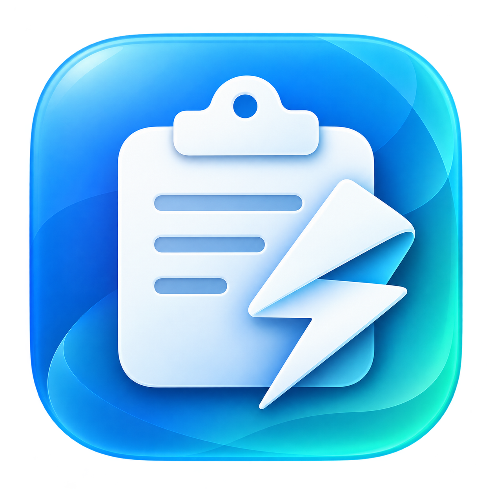

<p align="center">
  
</p>

# QuickPaste

> A lightweight macOS menu bar clipboard history app — press ⌘⇧V to search and paste.

QuickPaste 是一个轻量的 macOS 菜单栏剪贴板历史工具：按 **⌘⇧V** 在屏幕中央呼出搜索面板，选中即粘贴到当前应用。

## 功能

- 自动记录复制过的纯文本和图片（截图、网页图片等），重复内容自动移到最前
- 默认保留最近 30 条，超出的旧记录连同图片文件一起删除；可在菜单栏“保留条数”中改为 10 / 30 / 50 / 100 / 200 或自定义
- 面板左侧列表显示图片缩略图，右侧预览选中的图片或完整文本；搜索“图片”可筛出所有图片
- macOS 26+ 使用原生液态玻璃面板，旧系统使用磨砂材质；默认亮色，面板右上角“深色”开关控制明暗并记住选择，不跟随系统外观；支持系统“减少透明度”“减少动态效果”设置
- 跳过密码管理器标记的敏感内容（`org.nspasteboard.ConcealedType` 等）
- 历史持久化在 `~/Library/Application Support/QuickPaste/history.json`，图片以 PNG 保存在同目录的 `images/` 中
- 仅驻留菜单栏，不占 Dock；支持开机启动

## 快捷键

| 按键 | 作用 |
|---|---|
| ⌘⇧V | 呼出 / 关闭面板 |
| 直接输入 | 搜索过滤 |
| ↑ / ↓ | 选择 |
| ↩ | 粘贴选中项 |
| ⌘1 – ⌘9 | 直接粘贴对应条目 |
| ⌘⌫ | 删除选中项 |
| esc | 关闭面板 |

## 安装

无需自行编译：从 [GitHub Releases](https://github.com/cutey-none/QuickPaste/releases/latest) 下载 DMG 与对应的 `.sha256` 校验文件。

当前 **v0.0.1** 提供 [Apple 芯片版 DMG](https://github.com/cutey-none/QuickPaste/releases/download/v0.0.1/QuickPaste_0.0.1_arm64.dmg) 和 [SHA-256 校验文件](https://github.com/cutey-none/QuickPaste/releases/download/v0.0.1/QuickPaste_0.0.1_arm64.dmg.sha256)。Intel Mac 暂需按下文从源码构建。

支持 **macOS 13+**。DMG 文件名中的 `arm64` 对应 Apple 芯片，`x86_64` 对应 Intel；本地构建默认生成当前 Mac 架构的安装包。

1. 双击 `QuickPaste_<版本>_<架构>.dmg`。
2. 把 **QuickPaste.app 拖到 Applications（应用程序）**。
3. 弹出磁盘映像，从“应用程序”打开 QuickPaste。
4. 启动后图标出现在屏幕右上角的菜单栏中，按 **⌘⇧V** 呼出面板；如需开机启动，在菜单栏中开启。

### 首次打开下载的应用

当前构建使用 **ad-hoc 签名**，尚未使用 Apple Developer ID 签名和公证。从网络下载后，macOS 可能提示无法验证开发者。在尝试打开后，到 **系统设置 → 隐私与安全性 → 仍要打开**，按系统提示确认。

确认安装包来源可信时，也可以只清除 QuickPaste 的下载隔离标记，再打开：

```bash
xattr -dr com.apple.quarantine /Applications/QuickPaste.app
open /Applications/QuickPaste.app
```

DMG 的 SHA-256 校验文件与安装包一起生成。把两个文件放在同一目录，运行：

```bash
shasum -a 256 -c QuickPaste_<版本>_<架构>.dmg.sha256
```

### 更新与卸载

更新前先从菜单栏退出 QuickPaste，再打开新 DMG，将应用拖到 Applications 并选择替换，随后重新打开。历史记录和偏好设置保存在用户目录中，替换应用不会删除它们。

卸载时退出 QuickPaste，删除 `/Applications/QuickPaste.app`。如需同时删除剪贴板历史，删除 `~/Library/Application Support/QuickPaste/`；偏好设置可用 `defaults delete com.cutey.QuickPaste` 清除。

## 构建与运行

QuickPaste 使用 Swift / AppKit / SwiftUI，无需安装 Node.js、Rust 或第三方打包工具。

| 工具 | 要求 | 用途 |
|---|---|---|
| macOS | 13+ | 构建与运行 |
| Swift | 5.9+ | 编译应用 |
| Xcode Command Line Tools | 较新版本 | macOS SDK 与系统打包工具 |
| 完整 Xcode | 运行测试时需要 | XCTest |

安装命令行工具：`xcode-select --install`。

```bash
git clone https://github.com/cutey-none/QuickPaste.git
cd QuickPaste
./scripts/build-dmg.sh      # 生成带图标的 .app、.dmg 和 SHA-256 校验文件
open build                 # 打开输出目录
```

输出示例（0.0.1，Apple 芯片）：

```text
build/
  QuickPaste.app
  QuickPaste_0.0.1_arm64.dmg
  QuickPaste_0.0.1_arm64.dmg.sha256
```

只构建应用并直接运行：

```bash
./scripts/build-app.sh
open build/QuickPaste.app
```

更新源码后重新打包：

```bash
git pull
./scripts/build-dmg.sh
```

版本号与构建号在 `Support/Info.plist` 中配置。打包脚本先生成完整应用（含图标），再签名并严格验证签名；DMG 使用只读压缩格式，包含应用和指向 `/Applications` 的快捷入口。本地构建会设置 Finder 图标布局；`CI=true` 时跳过该步骤，安装方式相同。

## 验证

检查脚本语法、运行单元测试、生成并验证安装包：

```bash
for script in scripts/*.sh; do bash -n "$script"; done
swift test
./scripts/build-dmg.sh
codesign --verify --strict --verbose=2 build/QuickPaste.app
hdiutil verify build/QuickPaste_0.0.1_arm64.dmg  # Intel 使用 x86_64 文件名
```

若测试报 `no such module 'XCTest'`，安装完整 Xcode，并在必要时切换开发者目录：

```bash
sudo xcode-select -s /Applications/Xcode.app/Contents/Developer
swift test
```

## 辅助功能权限

自动粘贴需要模拟 ⌘V，因此需要在 **系统设置 → 隐私与安全性 → 辅助功能** 中允许 QuickPaste。
未授权时，选中的内容仍会写入剪贴板，手动按 ⌘V 即可。

> 应用使用 ad-hoc 签名，每次重新构建后签名会变化，可能需要在辅助功能列表中移除旧条目后重新授权。

## 项目结构

```
Sources/
  QuickPasteCore/   历史存储（去重、上限、搜索、持久化），有单元测试
  QuickPaste/       应用：菜单栏、全局快捷键、剪贴板监听、面板 UI、粘贴
Support/Info.plist  应用 bundle 配置与版本号
Support/logo.png    logo 原图，README 与应用图标共用
Support/QuickPaste.icns  macOS 应用图标
scripts/
  build-icon.sh     从 logo 生成各尺寸图标与 icns
  build-app.sh      编译、组装应用并签名验证
  build-dmg.sh      生成拖拽安装 DMG 与校验文件
```

图标原图由内置 imagegen 生成；设计提示词与再生成说明见 [Support/LOGO.md](Support/LOGO.md)。

## License

MIT
